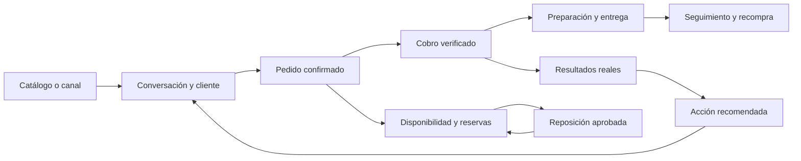

# Plan de evolución de Kova hacia automatización de negocio E2E

Fecha: 2026-10-18. Estado: dirección solicitada por el propietario y propuesta de ejecución por fases.
Riesgo de esta entrega: planeación. Las fases futuras involucran datos, seguridad, proveedores y dinero.

Actualización de ejecución: el propietario solicitó implementar con agentes. El
[informe de implementación local](../audits/KOVA-E2E-IMPLEMENTATION-2026-10-18.md) distingue las
capacidades desarrolladas, sus pruebas y los pendientes de canales/proveedores. La propuesta
completa de abajo sigue siendo horizonte de producto; no representa disponibilidad general.

Actualización 2026-10-19: los cortes internos de agenda/lealtad y
[atención postventa](../audits/KOVA-SERVICE-CASES-2026-10-19.md) ya tienen implementación local
acotada. Atención incorpora responsables, historia con autor, reapertura y vencimientos manuales;
no completa campañas, entrega externa, compensaciones ni atribución causal. Las brechas de abajo
son el diagnóstico original del 2026-10-18: para disponibilidad y validación vigentes consultar
los informes y `current-sprint.md`. La [cola operativa interna](PLAN-COLA-OPERATIVA-INTERNA.md)
tiene backend y UI implementados y validados localmente; la publicación permanece pendiente. Es una consulta de fuentes existentes, sin procesamiento ni efectos externos.

Kova debe conectar captación, atención, venta, operación y recompra sobre los datos reales del negocio.
La propuesta amplía el [copiloto del dueño](PLAN-KOVA-COPILOT.md): detectar, explicar, recomendar,
ejecutar y medir. El resultado buscado es reducir trabajo manual y cerrar pendientes con trazabilidad.

Esta entrega autoriza y documenta la dirección de producto; no activa módulos, campañas, proveedores,
gastos o mutaciones autónomas. El [sprint vigente](../current-sprint.md) conserva sus prioridades y
gates. Cada corte pasa a ejecución con spec, BDD, aceptación y alcance explícito; el horizonte amplio
no es una promesa de que todo está implementado ni un compromiso de fechas.

## Referente competitivo

Consulta de oferta pública el 2026-10-18 mediante tres frentes: investigación competitiva, cobertura
de producto y preparación técnica. No hubo acceso al producto privado de Colega ni operaciones reales.

| Oferta | Qué anuncia | Implicación para Kova |
|---|---|---|
| [Sistema Colega](https://www.colegastudio.com/) | CRM, pipeline, bandeja WhatsApp/Instagram/correo, IA comercial, agenda, seguimiento y atribución. Declara basarse en GoHighLevel. | Integrar adquisición y relación comercial con la operación existente. |
| [Equipos de ventas](https://www.colegastudio.com/equipos-de-ventas) | Línea empresarial, asignación/reasignación, notas, permisos e historial de atención. | La relación debe pertenecer al negocio y continuar al cambiar de empleado. |
| [Colega Menus](https://menus.colegastudio.com/) | POS, cocina, mesas, tienda, reparto, finanzas e IA para restaurantes. | Existe competencia directa en operación; comparar el recorrido completo. |
| [Funciones Menus](https://menus.colegastudio.com/funciones) | Pedidos programados, cuentas por mesa, recetas e inventario, CEDIS y franquicia. | Compartir catálogo, pedido e inventario entre canales; especializar por giro después. |
| [Colega Cards](https://www.colegastudio.com/colega-cards) | NFC/QR, satisfacción, alertas de inconformidad y reseñas; tarjeta individual anunciada en $399 MXN. | Conectar postventa e incidentes con una compra real. |

[Precios de Sistema Colega](https://www.colegastudio.com/precios), MXN mensuales con IVA según el sitio:

| Plan | Mensualidad | Implementación inicial |
|---|---:|---:|
| Lite | $2,499 | $6,997 |
| Access | $5,899 | $12,997 |
| Smart | $8,899 | $18,997 |
| Complete | $13,899 | Cotización |

Access, Smart y Complete publican tokens IA adicionales. La implementación incluye configuración y
capacitación. La matriz gráfica no permite atribuir todas las funciones a todos los planes.

[Precios de Menus](https://menus.colegastudio.com/precios): Complete $499 y Escala $799 MXN por
sucursal al mes, IVA incluido; procesamiento de Mercado Pago y extras IA aparte. Escala anuncia
reservas, recetas/inventario y organización CEDIS/franquicia. Offline, impresión en nube, captura de
delivery, CFDI y avisos WhatsApp aparecen como próximos. La demo utiliza cifras de ejemplo.
Estos son precios y afirmaciones publicados, no verificación de disponibilidad, rendimiento o seguridad.

El aprendizaje comercial es combinar configuración guiada, continuidad del equipo y procesos
conectados. No se adoptan su estructura de precios ni sus afirmaciones de ahorro. Para reputación,
Kova ofrecerá solicitud neutral de reseñas y atención privada en paralelo: la
[política de Google](https://support.google.com/contributionpolicy/answer/7400114?hl=en) prohíbe
solicitar selectivamente reseñas positivas. El acceso a reseñar no dependerá de la satisfacción.

## Posición de producto propuesta

**Kova conecta lo que te piden, lo que vendes y lo que necesitas hacer para que tu negocio siga funcionando.**

La ventaja a desarrollar es cerrar acciones con ventas, disponibilidad y costos comprobables.
Un mensaje respondido no equivale a venta; una compra de mercancía no equivale a pago a proveedor;
una venta registrada como tarjeta manual no equivale a una tarjeta procesada por Kova.

El primer segmento propuesto sigue siendo panaderías, cafeterías y comercio pequeño con pedidos
para recoger o entregar. Validar demanda con esos negocios antes de ampliar a servicios con citas,
restauración especializada o franquicias. La interfaz mostrará módulos según necesidad y preparación.

## Cobertura actual y brechas

“Implementado” describe repositorio y evidencia indicada; no implica activación general por tenant.
La aceptación productiva documentada del 2026-10-10 está en el sprint vigente; no se repitió aquí.

| Recorrido | Base comprobada | Brecha para E2E |
|---|---|---|
| Captar | Landing de Kova; catálogo interno | Catálogo público de cada negocio, QR y formularios vinculados a origen. La landing SaaS no es tienda del tenant. |
| Atender | Clientes e historial en `backend/app/customers/` | Consentimiento por canal, conversaciones, responsables, prospectos y pipeline. |
| Cotizar y comprometer | Pedidos con snapshots, reservas y estados en `backend/app/customer_orders/` | Cotizaciones y conversión desde conversación; no hay agenda ni conexión WhatsApp. `phone_whatsapp` es captura manual. |
| Vender y cobrar | POS, pagos registrados, tickets, devoluciones, dividido y offline en `backend/app/orders/` y `backend/app/sync/` | Procesamiento PSP, links y conciliación externa. Stripe Billing cobra la suscripción de Kova. |
| Preparar y entregar | Pedidos con transición a entrega y vínculo a venta pagada | Avisos, SLA y escalamiento; reparto/KDS/mesas especializados no están cubiertos por el pedido básico. |
| Abastecer | Inventario, lotes, reservas, traspasos; compras y recepción parcial en `backend/app/purchasing/` | Alerta → borrador aprobado → comunicación con proveedor → recepción. No hay pago automático ni cuentas por pagar. |
| Controlar dinero | Gastos, turnos, reportes y snapshots de costo | [Conciliación bancaria](../../specs/reconciliation/bank_reconciliation.md) especificada, sin implementación; crédito y vencimientos siguen pendientes. |
| Facturar | Adaptador/onboarding CFDI en `backend/app/cfdi/` | Cuenta de plataforma, requisitos del emisor y aceptación Live por negocio. La aceptación de Sweet Home no acredita emisión real. |
| Decidir | Asistente grounded, señales y reposición calculada con datos reales | Convertir recomendaciones en operaciones autorizadas y medir su resultado. |
| Fidelizar | Historial de compras | Seguimiento consentido, satisfacción, incidentes, recompra, lealtad y atribución. |
| Orquestar | Jobs, leases, alarmas y outbox del asistente | Eventos de dominio persistidos, reglas versionadas, ejecuciones y conectores comerciales. |

Contratos a preservar: [pedidos](../../specs/customer_orders/customer_orders.md),
[compras](../../specs/purchasing/purchasing.md), [clientes](../../specs/customers/customers_barcodes.md),
[reposición](../../specs/reports/restock_decisions.md), [CFDI](../../specs/integrations/cfdi-contract.md)
y [operación del asistente](../assistant-operations.md).

Pedidos requiere su flag y acceso comercial; el código vigente lo habilita por defecto y permite
desactivarlo por negocio. El asistente depende de
cohorte y capacidades autorizadas. Nuevas cargas e ingesta documental permanecen desactivadas por
la decisión de mantener Workers Free. `provider-readiness.md` conserva una descripción fiscal
anterior al adaptador actual: no usarla sola para afirmar que CFDI está ausente.

## Recorrido objetivo y primer corte

Recorrido completo deseado: un cliente consulta, Kova recupera precios/disponibilidad reales,
prepara un pedido revisable, confirma las condiciones y verifica el cobro mediante el medio
autorizado. Después acompaña preparación/entrega y seguimiento consentido. Las reservas se consumen
al cobrar conforme al contrato vigente. Reportes distinguen vendido, devuelto y pendiente.

**Primer corte propuesto:** pedido listo → aviso consentido → entrega registrada → seguimiento
medible. Se elige porque aprovecha un dominio existente y prueba eventos, autorización, comunicación
y resultado sin exigir resolver primero captación, CRM, agenda y procesamiento electrónico.
Antes de habilitar un canal externo, la misma plantilla puede validar tareas internas; eso prueba
orquestación, pero no cierra el recorrido de comunicación con el cliente.

## Arquitectura incremental

Mantener FastAPI y PostgreSQL, el rol runtime con RLS, el Worker privado y las alarmas actuales.
Aplicar el patrón:

`servicio de dominio → evento transaccional → regla versionada → ejecución durable → política o aprobación → servicio autorizado → outbox → confirmación → resultado`

`backend/app/assistant/events.py` actualiza un puntero agregado por tenant con `happened_at`.
Sirve para recalcular señales; no es un registro reproducible de cada venta o cambio de pedido.
`executor.py` confirma configuración/catálogo/sucursales/invitaciones, y no debe abrirse a
operaciones arbitrarias. `notifications.py` ya aporta patrones de outbox e incertidumbre externa.

Entidades propuestas, todavía sin migración ni contrato público:

- Evento: identidad, tenant/sucursal, entidad y versión, tipo, fecha y correlación; payload mínimo.
- Regla y versión: disparador, condiciones, acciones permitidas, límites, estado y autorización.
- Ejecución y paso: estado, intentos, próxima fecha, causa, efecto y claves de deduplicación.
- Autorización: actor, alcance, límites, vigencia y revocación; nunca deriva de texto del cliente.
- Operación externa: proveedor, referencia, clave idempotente, estado confirmado o incierto y recibos.
- Consentimiento: cliente, canal, finalidad, origen, fecha y retirada; independiente del teléfono.

Evento y mutación se guardan en la misma transacción. Entrega de trabajos al menos una vez con
efectos idempotentes, control de versión por entidad y ledger por proveedor; no prometer exactamente
una vez a través de servicios externos. Timeout incierto exige consulta/reconciliación y conserva
el estado, sin repetir un cobro, factura o mensaje a ciegas.

La IA interpreta o redacta sobre evidencia; los servicios calculan importes, permisos y stock.
Las plantillas deterministas funcionan sin inferencia por evento. Las conversaciones externas son
datos no confiables y no dan instrucciones al motor, acceso a secretos, SQL o herramientas libres.
La suspensión humana de una conversación impide nuevas respuestas automáticas hasta reanudación.

## Secuencia y backlog verificable

Responsables indicados por función; asignación de personas y estimaciones al preparar cada sprint.
Los IDs siguientes son nuevos de este plan, no tickets ni implementación existente.

| ID / prioridad | Entregable y valor | Responsable / áreas | Aceptación y QA |
|---|---|---|---|
| E2E-01 / P0 | Taxonomía y eventos; evitar acciones perdidas o repetidas | Backend/datos; pedidos, ventas, inventario, migración aditiva | Commit y rollback comunes; replay deduplicado; orden por entidad; RLS tenant/sucursal; pruebas concurrentes y recuperación tras caída. |
| E2E-02 / P0 | Motor de una plantilla y centro de ejecución; dueño ve pendientes y errores | Backend/frontend; patrón worker/outbox y futura vista de automatizaciones | Pausar/cancelar, historial, próxima ejecución y causa real; versión fija; recuperación de lease; error visible sin doble efecto. |
| E2E-03 / P0 | Políticas y aprobación; controlar qué puede hacer Kova | Seguridad/producto; RBAC, billing, executor y servicios | Revocar detiene pendientes; revalidar permisos/billing al ejecutar; cambios de stock/precio invalidan propuesta; límites por regla/tenant. |
| E2E-04 / P1 | Identidad y consentimiento; continuidad del cliente | Backend/producto; clientes, pedidos, futura conversación | Vínculos explícitos prospecto–cliente–pedido–venta; no fusionar teléfonos ambiguos; baja bloquea pendientes; notas internas privadas y auditoría sin PII cruda. |
| E2E-05 / P1 | Primer canal oficial, propuesto WhatsApp; aviso de pedido listo | Integraciones/soporte; adaptador, inbound webhook, outbox y UI | Verificar contrato/costos/políticas del proveedor; webhook auténtico y replay-safe; tenant resuelto por cuenta registrada; estados enviado/entregado/fallido distintos; human handoff; sandbox y aceptación real controlada. |
| E2E-06 / P1 | Postventa simple; cerrar el primer recorrido | Producto/QA; pedidos, consentimiento, reglas | Aviso único por versión pertinente, sin envío tras cancelación; registrar entrega; seguimiento dentro del horario elegido, baja y frecuencia máxima; trazabilidad hasta venta. |
| E2E-07 / P1 | Catálogo/QR y atención a pedido; crecimiento conectado | Frontend/backend; catálogo público, solicitudes, clientes, pedidos | Exponer sólo catálogo publicable; disponibilidad validada de nuevo al confirmar; repetición no duplica pedido/reserva; ningún ingreso antes del cobro. |
| E2E-08 / P2 | Pipeline y cotizaciones ligeras; no olvidar oportunidades | Producto/comercial; nuevos dominios y conversación | Responsable, etapa, próxima acción, vencimiento e historial; cotización separada de venta; conversión conserva snapshots y confirma cambios. |
| E2E-09 / P2 | Reposición asistida; menos faltantes | Inventario/datos; reportes y purchasing | Mostrar stock disponible/reservado, velocidad y proveedor elegido; faltantes de costo/plazo explícitos; borrador y aprobación antes de envío; recepción física confirmada, nunca deducida del mensaje. |
| E2E-10 / P2 | Cobros electrónicos y conciliación; dinero confirmado | Integraciones/seguridad; adaptador PSP y spec de conciliación | Separación de Stripe Billing; proveedor y cuenta del negocio verificados; sandbox, webhooks, importes MXN, duplicados, reversas, timeouts y operación real controlada antes de expansión. |
| E2E-11 / P2 | Fiscal y vencimientos; cerrar obligaciones | Fiscal/producto; CFDI, conciliación y futuro crédito | Reusar adaptador actual; emisor listo y Live validado; exclusión individual/global; reembolso/cancelación reconciliados; crédito requiere spec propia, no inferir cartera desde pedidos sin cobrar. |
| E2E-12 / P2 | Recompra, reseñas e incidentes; retención medible | Producto/marketing/datos; consentimientos, reglas y reportes | Solicitud neutral de reseña; incidencias con responsable; campañas sólo con consentimiento, bajas, topes y cohorte; atribución desconocida visible y margen sólo con costos disponibles. |

Orden de cortes:

1. **Fundación:** E2E-01–03; una plantilla con tareas internas. Gate: recuperación, RLS, auditoría y revocación probadas.
2. **Primer circuito con cliente:** E2E-04–06; E2E-05 depende del consentimiento y las políticas de ejecución. Gate: un pedido real trazable hasta entrega y seguimiento, sin duplicados.
3. **Captación y abastecimiento:** E2E-07–09; pipeline sólo cuando el negocio necesite oportunidades anteriores al pedido. Gate: conversión y reposición conservan contratos e inventario.
4. **Dinero y retención:** E2E-10–12; pueden prepararse en paralelo cuando sus proveedores y dependencias estén listos. Gate: conciliación y resultados reales, sin estados financieros inferidos.

Citas/recordatorios por capacidad, lealtad/promociones, mesas/KDS/recetas, logística avanzada,
voz, contratos/firma, cursos/comunidades, CEDIS/franquicia y API pública permanecen como extensiones
del horizonte. Elegir construir o integrar por demanda, costo, soporte y encaje con el giro. No son
requisitos del primer circuito ni se habilita un constructor universal de workflows al inicio.

## Autonomía, privacidad y costos

- Lecturas y señales: evidencia real y permisos vigentes; el dato faltante produce estado vacío.
- Comunicaciones: activación explícita por finalidad/canal/plantilla, responsable y límites; respetar bajas antes de cada envío.
- Borradores: propuesta revisable sin compromiso comercial ni cambio financiero automático.
- Dinero, fiscal, precio, stock y compromiso de compra: acción concreta aprobada y ejecutada por servicio del dominio. Automatizar después sólo con política específica y validación propia.
- Toda regla conserva tenant, sucursal y propietario de datos; el worker no recibe conexión privilegiada. UI mantiene cookies HttpOnly y ningún token en Web Storage.
- No almacenar contenido crudo en eventos/auditoría; definir acceso, retención, exportación y borrado de conversaciones, recibos y consentimientos en cada spec.
- Respetar aislamiento Test/Live y gates de despliegue. No contratar ni activar proveedores como efecto implícito de esta propuesta.

La arquitectura del 2026-10-18 en [contexto vigente](../claude/architecture-context.md) y
[operación de Workers](../../deploy/cloudflare-backend/README.md) prevalece sobre referencias
históricas a Fly. Medir CPU, duración de alarmas, espera, solicitudes, almacenamiento y costo externo
por tenant antes de ampliar cohortes. Free no implica capacidad ilimitada ni mensajería gratuita.
No reactivar ingesta ni Fly para cumplir este plan sin decisión específica.

Para evaluar viabilidad registrar costo por conversación atendida, pedido completado y acción útil;
incluir canal, inferencia, almacenamiento, procesamiento y soporte. Mantener pricing y planes Kova
vigentes; cualquier cambio comercial requiere análisis separado de costo y disposición a pagar.

## Métricas y criterio de expansión

Métrica propuesta: negocios que completan semanalmente un circuito automatizado útil con evidencia,
entre negocios habilitados con al menos un evento elegible. Tarea creada o mensaje generado no basta:
el circuito requiere condición final verificada, por ejemplo entrega o compra recibida.

Medir además tiempo manual antes/después, pedidos listos sin recoger, tiempo de respuesta y entrega,
conversión de conversación a venta cobrada, fallos/duplicados, bajas de comunicación, costo por
circuito y recompra. Conservar categoría sin atribución; una venta posterior a un mensaje no prueba
causalidad. Beneficio incremental requiere comparación de cohortes o experimento.

Hipótesis de piloto, no resultados ni fechas comprometidas: tres a cinco negocios durante dos a
cuatro semanas, según su volumen. Capturar línea base, acordar umbrales antes de activar y revisar
semanalmente. Para ampliar: cero mezcla de tenants y doble efecto financiero, todos los intentos
trazables, bajas/revocación efectivas, fallos recuperables y ahorro de tiempo medido frente a costo.
No ampliar sólo por un porcentaje sobre una muestra pequeña.

## Validación de esta entrega y próxima ejecución

Esta entrega revisa docs, contratos y módulos; valida enlaces locales y diff, sin alterar runtime.
No ejecuta proveedores, mensajería, ventas, fiscal ni despliegues. La cobertura de producción actual
se toma de evidencia fechada y no acredita las capacidades propuestas.

El siguiente paquete de implementación es la spec de E2E-01–03 y la plantilla de pedido listo,
con BDD de duplicados, rollback, versiones, baja, revocación, aislamiento, worker interrumpido y
proveedor incierto. QA de cada corte seguirá la matriz existente y recorrerá navegador → API →
dominio → worker → proveedor → callback → estado visible; mocks prueban contratos, no entrega real.
